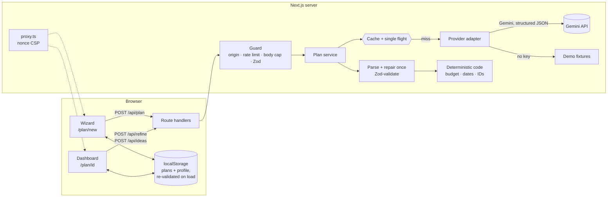

# Architecture

Festivo is one Next.js 16 app (App Router, React 19, TypeScript strict). Pages render on the
server; three route handlers talk to the AI; plans live in the visitor's browser. Business rules
are small pure functions in `lib/`, and components stay thin.



## Layers

| Layer               | Where                                                                              | Responsibility                                                                                                                          |
| ------------------- | ---------------------------------------------------------------------------------- | --------------------------------------------------------------------------------------------------------------------------------------- |
| Pages               | `app/`                                                                             | Server components by default. Landing page, wizard, dashboard, 404, error boundary, route handlers.                                     |
| Request guard       | `proxy.ts`, `lib/http/`                                                            | Per-request CSP nonce; cross-site check, rate limit, streamed body cap, strict request schemas.                                         |
| Plan service        | `lib/plan/service.ts`                                                              | Generate (streamed), refine, "more like this". Provider-agnostic; caches; never trusts the model.                                       |
| AI adapter          | `lib/ai/`                                                                          | `AiProvider` interface; Gemini and demo implementations; prompts; parsing and the repair retry.                                         |
| Domain rules        | `lib/budget`, `lib/timeline`, `lib/vendors`, `lib/ideas`, `lib/events`, `lib/plan` | Pure, tested functions: allocation and rebalancing, dates and the `.ics` file, vendor catalogues, occasion profiles, patches and diffs. |
| Schemas             | `lib/schemas/`, `lib/ai/schemas.ts`                                                | Zod for every input, every AI reply and everything read back from storage.                                                              |
| Security primitives | `lib/security/`                                                                    | Headers, rate limiter, text cleaning, prompt delimiting.                                                                                |
| Client state        | `lib/store/`, `hooks/`                                                             | Zustand stores persisted to `localStorage` with debounced writes and validated hydration.                                               |
| Components          | `components/`                                                                      | `ui` (Radix primitives, restyled), `a11y`, `landing`, `onboarding`, `wizard`, `plan`.                                                   |

## Generating a plan

1. The wizard validates each step with the same Zod schema the server uses
   (`lib/wizard/draft.ts`) and keeps the draft in the store, so a reload loses nothing.
2. `POST /api/plan` (`app/api/plan/route.ts`) runs the guard: `Sec-Fetch-Site` and `Origin`,
   the per-client rate limit (a plan costs 2 tokens), a 16 KB streamed body cap, text cleaning,
   the strict schema, then a check that the date is not in the past in the visitor's time zone.
3. `streamPlan` (`lib/plan/service.ts`) hashes the normalised input with SHA-256. A cache hit
   returns at once with a fresh ID; an identical request already in flight is joined rather
   than repeated.
4. One combined call asks the provider for a **lean draft** in structured JSON: budget lines,
   tasks as "days before", vendor questions, ideas, a summary. As each section's key appears in
   the stream, a progress event goes to the browser ("Crunching your budget…"), and the wizard
   reads it aloud through a polite live region.
5. The reply is parsed and validated; if it fails, one repair prompt with the exact issues is
   sent; if that fails, the browser gets a friendly, retryable error.
6. `planFromDraft` (`lib/plan/fromDraft.ts`) turns the draft into a `Plan` with code, not trust:
   amounts re-normalised to the exact total with largest-remainder rounding, task dates computed
   and clamped between today and the event, IDs generated, unknown categories dropped and
   missing ones filled.
7. The response is NDJSON: progress events, then one `plan` or `error` event. The browser saves
   the plan and opens `/plan/[id]`.

Refine and "more like this" follow the same path with one section only. Refine returns a
**patch** limited by a strict allow-list schema; code applies it (`lib/plan/patch.ts`), computes
a readable diff (`lib/plan/diff.ts`), and nothing changes until the visitor accepts.

## Providers

`AiProvider` (`lib/ai/provider.ts`) streams JSON text for a structured task and nothing else, so
adding a provider is one file. `getProvider()` picks Gemini when `GEMINI_API_KEY` is set and demo
mode otherwise. Gemini (`lib/ai/gemini.ts`) uses `responseJsonSchema`, a timeout, output token
caps and backoff retries for transient failures. Demo mode (`lib/ai/mock.ts`) builds realistic
plans from fixtures for all 36 occasions and understands common refine requests ("cut budget by
20%", "move it to March", "make it eco-friendly", "make it cheaper"), so the whole app works
without a key.

## The browser: fast first load

- **Server components by default.** The landing page's text, photos and hero render on the
  server and work without JavaScript.
- **Lazy motion.** GSAP, ScrollTrigger and Lenis load after first paint, and never under reduced
  motion (`components/landing/LandingMotion.tsx`).
- **Deferred code.** The account menu loads after hydration; the wizard is fetched while new
  planners fill in the account form; the dashboard's hidden tabs, the Refine sheet and the share
  menu are separate chunks that start loading when it mounts (`components/plan/deferred.tsx`),
  with identical stand-ins that remember a click.
- **Per-photo imports.** Client components import single photos, so each page ships only the
  blur placeholders it shows.
- **Budgets enforced.** `npm run bundle:check` gzips every route's first-load chunks after a
  build and fails CI over budget: 150 KB for the landing page (the brief's target), ratchets just
  above today's size for the planner pages.
- **Cheap persistence.** Store writes are debounced and flushed when the page is hidden;
  expensive derived values (budget totals, effective budgets) are memoised.

## Security

Every mitigation is listed, with its file and test, in [SECURITY.md](SECURITY.md).

## Decisions

| Decision                                           | Why                                                                                                |
| -------------------------------------------------- | -------------------------------------------------------------------------------------------------- |
| Per-request nonce CSP, so pages render per request | A strict `script-src` with `'strict-dynamic'`; partial prerendering cannot carry nonces.           |
| The AI returns a lean draft, code builds the plan  | Budgets always sum and dates are always valid, whatever the model does.                            |
| No server accounts or database                     | Nothing to breach; plans stay on the visitor's device. Re-validated on every load.                 |
| Budget math in whole currency units                | No floating-point drift; largest-remainder rounding keeps the exact total.                         |
| Hand-drawn SVG donut instead of a chart library    | A few hundred bytes instead of tens of kilobytes; the editable table is the accessible equivalent. |
| Print stylesheet for PDF export                    | No PDF library in the bundle; every tab prints.                                                    |
| Light theme only, device-only motion preference    | The owner's design choice; contrast is tested for the one theme.                                   |
| In-memory cache and rate limiter                   | Right for one instance; documented as the first thing to move to Redis when scaling out.           |

## Repository map

```
app/                 pages, error boundary, route handlers (api/plan, api/refine, api/ideas)
app/styles/          stylesheets by concern: accessibility, print, landing, buttons, onboarding
proxy.ts             per-request nonce CSP (Next.js 16 middleware)
components/          a11y · brand · landing · layout · onboarding · plan · ui · wizard
hooks/               store hydration, streamed plan generation
lib/                 ai · budget · cache · design · events · fixtures · http · ideas · landing
                     plan · prefs · profile · schemas · security · store · timeline · vendors · wizard
public/              photographs (Unsplash License), prefs-init.js
scripts/             bundle-budget.mjs
tests/               unit · api (MSW) · component (jsdom) · e2e (Playwright + axe) · setup
docs/                the original brief, design research, photo credits
```
