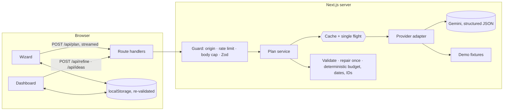

# Festivo

> Planned to the last petal.

**A GenAI planning assistant that helps people organize weddings, birthdays and community
events with budgets, timelines, vendor checklists and personalized ideas.**

Answer six short questions (what you are celebrating, when and where, the budget, the style,
the must-haves) and Festivo builds a complete plan you can edit, refine in plain words, export to
your calendar and print. It works without an API key in demo mode, and with Google Gemini when
one is set.

## The problem, end to end

| The problem statement asks for… | Festivo                                                                                                                                                                                                                                                                                                |
| ------------------------------- | ------------------------------------------------------------------------------------------------------------------------------------------------------------------------------------------------------------------------------------------------------------------------------------------------------ |
| **Weddings**                    | Weddings, engagements and anniversaries, with the wedding functions (haldi, mehendi, sangeet…), a wedding budget split and vendor list, and a run sheet for the day.                                                                                                                                   |
| **Birthdays**                   | Birthdays and other life moments (baby showers, naming ceremonies, graduations, housewarmings), with the age being celebrated, children, cake and entertainment.                                                                                                                                       |
| **Community events**            | Festivals (Diwali, Holi, Eid, Christmas, Navratri, pujas, street festivals), meetups and clubs, conferences, hackathons, workshops and fundraisers: 36 occasions in four groups, each with its own questions (online or in person, free or ticketed, capacity, days), budget split, vendors and tasks. |
| **Budgets**                     | An allocation that always adds up exactly; a donut and an editable table; locks; proportional rebalancing; actual spend with over-budget warnings in words and icons; vendor quotes feed actual spend.                                                                                                 |
| **Timelines**                   | Tasks on real dates counted back from the event ("12+ weeks" to "After"), done/undo, add, edit, delete with undo, a day-of run sheet, and a `.ics` calendar export.                                                                                                                                    |
| **Vendor checklists**           | Vendors suited to the occasion, each moving To research → Contacted → Quoted → Booked → Paid, with quotes, notes and AI-written questions to ask.                                                                                                                                                      |
| **Personalized ideas**          | Theme, décor, food and drink, activities and favors that follow the chosen style, region, guest count and budget; cost tiers (₹ / ₹₹ / ₹₹₹), a "fits your budget" badge, save or dismiss, and "More like this" for one category at a time.                                                             |
| **GenAI**                       | One streamed generation with live progress, "Refine with AI" in plain words ("cut the budget by 20%", "move it to March") that previews every change before applying it, and personalized idea regeneration.                                                                                           |

For each of the three event families, Playwright runs the whole journey in demo mode, on a
desktop browser and a phone: wizard → generated plan → edit the budget → tick a task → export the
calendar. Refine, vendors and ideas are covered by end-to-end and component tests.

## How it scores on the judging criteria

| Criterion                       | What Festivo does                                                                                                                                                                                                                                                                                                                                                                                                                                                                                                                                                                                                                                                    |
| ------------------------------- | -------------------------------------------------------------------------------------------------------------------------------------------------------------------------------------------------------------------------------------------------------------------------------------------------------------------------------------------------------------------------------------------------------------------------------------------------------------------------------------------------------------------------------------------------------------------------------------------------------------------------------------------------------------------- |
| **Code quality**                | TypeScript `strict` plus `noUncheckedIndexedAccess`, `exactOptionalPropertyTypes` and `noImplicitReturns`. ESLint with type-aware rules (floating promises, exhaustive switches, deprecated APIs), the full `jsx-a11y` strict set, and maintainability ceilings (complexity 12, 100 lines per function, depth 4, 5 parameters, 400 lines per file) — zero warnings allowed. knip fails CI on any unused file, export or dependency. Business rules are small pure functions in `lib/`; components keep state in small hooks and render from short, single-purpose parts; a provider adapter keeps the AI swappable. Prettier, Husky and lint-staged on every commit. |
| **Security**                    | Key server-side only (enforced by `server-only` and a CI scan of the client bundle). Strict Zod on every input, AI reply and stored value. Streamed body caps, cross-site refusal, a forge-proof and flood-proof per-client rate limit, prompt-injection delimiting, an allow-listed refine patch, nonce CSP and a full set of hardening headers, generic errors. `npm audit`: 0 vulnerabilities. CodeQL and Dependabot. See [SECURITY.md](SECURITY.md).                                                                                                                                                                                                             |
| **Efficiency**                  | Server components by default; the landing page's first load is **147 KB** of gzipped JavaScript (brief: under 150 KB), enforced per route in CI. GSAP and Lenis load after first paint; hidden tabs, dialogs and the wizard are deferred. One combined AI call per plan, section-only refine and ideas, a SHA-256-keyed LRU cache, shared in-flight requests, bounded retries and token caps. Debounced storage writes, memoised totals.                                                                                                                                                                                                                             |
| **Testing**                     | 551 Vitest unit, API (MSW-mocked Gemini) and component tests covering 96% of the app's statements and 97% of its lines (99% of `lib/`), with ratchets so coverage can only go up; 77 Playwright end-to-end tests with axe on every screen, desktop and phone, against a production build. All run in CI.                                                                                                                                                                                                                                                                                                                                                             |
| **Accessibility**               | WCAG 2.2 AA: zero axe violations on every page, wizard step (with errors) and dashboard tab; keyboard-only journeys; managed focus; live regions for AI progress; 320px reflow and 200% text; forced-colours support; contrast-tested tokens; reduced motion honoured before first paint. See [ACCESSIBILITY.md](ACCESSIBILITY.md).                                                                                                                                                                                                                                                                                                                                  |
| **Problem statement alignment** | All three event types and all four planning tools, end to end, plus GenAI generation, refinement and ideas (table above). Works fully without a key.                                                                                                                                                                                                                                                                                                                                                                                                                                                                                                                 |

## Verify it yourself

| Check                | Command                                 | Result                                                                                      |
| -------------------- | --------------------------------------- | ------------------------------------------------------------------------------------------- |
| Lint                 | `npm run lint`                          | 0 errors, 0 warnings (type-aware rules, jsx-a11y strict, ceilings)                          |
| Types                | `npm run typecheck`                     | 0 errors                                                                                    |
| Formatting           | `npm run format:check`                  | Clean                                                                                       |
| Dead code            | `npm run knip`                          | No unused files, exports or dependencies                                                    |
| Unit, API, component | `npm run test:coverage`                 | 551 tests; whole app 96% of statements, 97% of lines (`lib/` 99% of lines), ratcheted in CI |
| End to end + axe     | `npm run test:e2e`                      | 77 tests on desktop and phone, all passing, zero axe violations                             |
| Bundle budget        | `npm run build && npm run bundle:check` | `/` 147 KB · `/plan/new` 197 KB · `/plan/[id]` 222 KB (gzipped first load)                  |
| Dependencies         | `npm audit`                             | 0 vulnerabilities                                                                           |

## Architecture



The details are in [ARCHITECTURE.md](ARCHITECTURE.md).

## Run it

You need Node.js 20.9 or newer (CI uses Node 24).

```bash
npm install
```

```bash
cp .env.example .env.local
```

```bash
npm run dev
```

Open <http://localhost:3000>. With `AI_PROVIDER=mock` (the default in `.env.example`) everything
works without a key. To use Gemini, put a key from Google AI Studio in `GEMINI_API_KEY` and set
`AI_PROVIDER=gemini` (or leave it unset).

### Environment

| Variable                    | Default                                  | Purpose                                                                                         |
| --------------------------- | ---------------------------------------- | ----------------------------------------------------------------------------------------------- |
| `AI_PROVIDER`               | Gemini if a key is set, otherwise `mock` | `mock` (demo fixtures) or `gemini`. Without a key it always falls back to demo mode.            |
| `GEMINI_API_KEY`            | —                                        | Server-side only; never sent to the browser.                                                    |
| `GEMINI_MODEL`              | `gemini-flash-latest`                    | Any Gemini model with structured JSON output.                                                   |
| `GEMINI_RETRIES`            | `2`                                      | Extra attempts for transient upstream failures (429, 5xx), 0 to 5.                              |
| `MOCK_STREAM_DELAY_MS`      | `1200`                                   | Demo mode's artificial delay, so the streamed progress is visible.                              |
| `API_RATE_LIMIT_PER_MINUTE` | `8`                                      | AI requests per client per minute; a whole plan costs 2.                                        |
| `TRUSTED_PROXY_HOPS`        | `1`                                      | Proxies in front of the app that append to `X-Forwarded-For` (2 behind an extra load balancer). |
| `NEXT_PUBLIC_SITE_URL`      | `http://localhost:3000`                  | Public URL; `https://` turns on HSTS and `upgrade-insecure-requests`. Read at build time.       |

### Scripts

| Script                  | What it does                                                        |
| ----------------------- | ------------------------------------------------------------------- |
| `npm run dev`           | Development server                                                  |
| `npm run build`         | Production build                                                    |
| `npm start`             | Serve the production build                                          |
| `npm run lint`          | ESLint with zero warnings allowed                                   |
| `npm run format:check`  | Prettier                                                            |
| `npm run typecheck`     | Generate route types, then `tsc --noEmit`                           |
| `npm test`              | Unit (Node), API (Node + MSW) and component (jsdom) tests           |
| `npm run test:coverage` | The same with coverage ratchets (whole app, and stricter on `lib/`) |
| `npm run test:e2e`      | Playwright and axe against a production build, in demo mode         |
| `npm run bundle:check`  | First-load JavaScript per route against its budget (after a build)  |

`npm run test:e2e` needs Playwright's Chromium once: `npx playwright install chromium`.

## Deploy

### Google Cloud Run

The `Dockerfile` is a three-stage build that runs Next.js's standalone server as an unprivileged
user on port 8080. Store the key in Secret Manager, then build, push and deploy (replace the
region, project and URL):

```bash
docker build --build-arg NEXT_PUBLIC_SITE_URL=https://festivo.example -t asia-south1-docker.pkg.dev/PROJECT/festivo/web .
```

```bash
docker push asia-south1-docker.pkg.dev/PROJECT/festivo/web
```

```bash
gcloud run deploy festivo --image asia-south1-docker.pkg.dev/PROJECT/festivo/web --region asia-south1 --allow-unauthenticated --set-secrets GEMINI_API_KEY=gemini-api-key:latest --set-env-vars AI_PROVIDER=gemini,TRUSTED_PROXY_HOPS=1
```

Behind an external HTTPS load balancer, set `TRUSTED_PROXY_HOPS=2`. The rate limiter and caches
are per instance; for many instances, move them to Redis.

### Vercel

Import the repository; Vercel detects Next.js. Add `GEMINI_API_KEY` (and optionally
`AI_PROVIDER=gemini`) as environment variables, and set `NEXT_PUBLIC_SITE_URL` to the production
URL so HSTS is sent. No other configuration is needed; `TRUSTED_PROXY_HOPS` stays at 1.

## Stack

Next.js 16 (App Router, Turbopack), React 19, TypeScript, Tailwind CSS 4, Radix primitives
(shadcn/ui, restyled), Zod 4, Zustand, GSAP and Lenis (landing page only), Google Gen AI SDK,
Vitest, Testing Library, MSW, Playwright with axe-core.

## Project documents

[ARCHITECTURE.md](ARCHITECTURE.md) · [SECURITY.md](SECURITY.md) ·
[ACCESSIBILITY.md](ACCESSIBILITY.md) · [the original brief](docs/BRIEF.md) ·
[design research](docs/design/research.md) · [photo credits](docs/design/photo-credits.md)

## License

[MIT](LICENSE). Photographs are used under the Unsplash License (see the photo credits).
